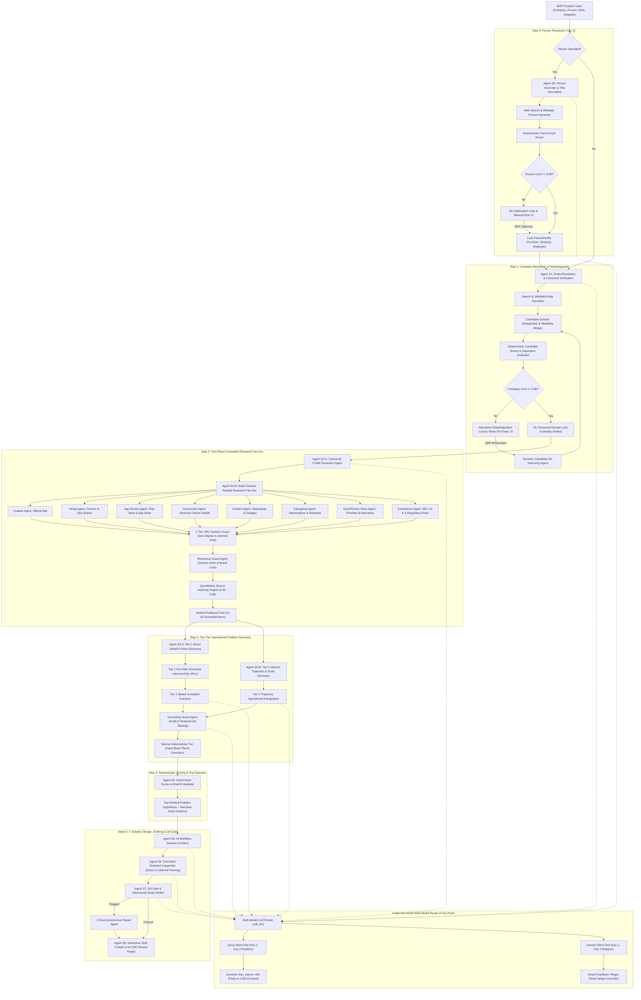
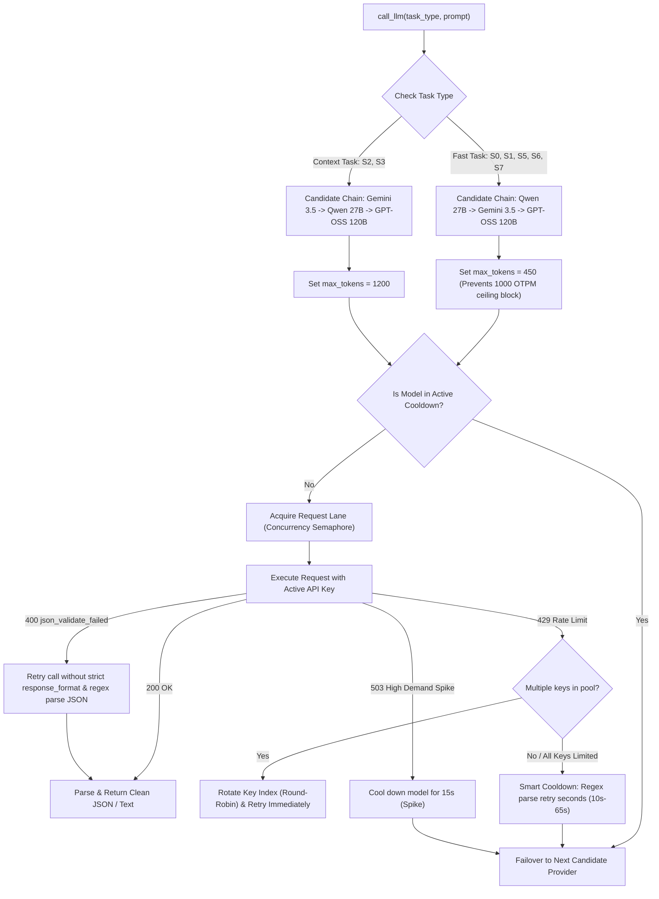

# Zamp AI Solutions Analyst — Grounded GTM Outreach Engine
## Complete Architectural Specification, Stage-by-Stage Documentation & System Reference

> **Case Study**: PS-3 GTM: Personalised Outreach — From Prospect to Draft  
> **System Status**: Fully Operational, Live on `http://localhost:8000`, 50+ Tests Verified  
> **Repository**: `GTM_Outreach`  
> **Last Updated**: November 2026  

---

## Table of Contents
1. [Executive Summary & Core Objectives](#1-executive-summary--core-objectives)
2. [End-to-End System Architecture & Multi-Agent Topology](#2-end-to-end-system-architecture--multi-agent-topology)
3. [Complete Step-by-Step Stage Walkthrough](#3-complete-step-by-step-stage-walkthrough)
   - [Step 0 (S0): Person-First Prospect Resolution & Role Normalization](#step-0-s0-person-first-prospect-resolution--role-normalization)
   - [Step 1 (S1): Entity Resolution, Disambiguation Gate & Dynamic Re-Discovery](#step-1-s1-entity-resolution-disambiguation-gate--dynamic-re-discovery)
   - [Step 2 (S2): Grounded Research Fan-Out, 2-Tier URL Partitioning & Source Authority](#step-2-s2-grounded-research-fan-out-2-tier-url-partitioning--source-authority)
   - [Special Ingestion: SDR Context Snippets & Injection Defense](#special-ingestion-sdr-context-snippets--injection-defense)
   - [Step 3 (S3): Two-Tier Problem Discovery & Dual Grounding Guards](#step-3-s3-two-tier-problem-discovery--dual-grounding-guards)
   - [Step 4 (S4): Deterministic Scoring, RoleFit Multipliers & Winner Selection](#step-4-s4-deterministic-scoring-rolefit-multipliers--winner-selection)
   - [Step 5 (S5): AI Workflow Solution Architecture Design](#step-5-s5-ai-workflow-solution-architecture-design)
   - [Step 6 (S6): Grounded Outreach Drafting & Style Differentiation](#step-6-s6-grounded-outreach-drafting--style-differentiation)
   - [Step 7 (S7): Deterministic QA Gate & Adversarial Swap Tests](#step-7-s7-deterministic-qa-gate--adversarial-swap-tests)
   - [Step 8 (S8): Human-in-the-Loop SDR Cockpit & Approval Workflow](#step-8-s8-human-in-the-loop-sdr-cockpit--approval-workflow)
4. [Under-the-Hood Engine: Multi-Model Router & Key Pool Manager](#4-under-the-hood-engine-multi-model-router--key-pool-manager)
5. [Database Schema & Event Streaming Protocol](#5-database-schema--event-streaming-protocol)
6. [API Specification & Endpoints](#6-api-specification--endpoints)
7. [Frontend Architecture & Visual Portals](#7-frontend-architecture--visual-portals)
8. [Anti-Hallucination & Safety Guardrails Matrix](#8-anti-hallucination--safety-guardrails-matrix)
9. [Chronological Incident & Failure-Mode Log](#9-chronological-incident--failure-mode-log)
10. [Architectural Decisions & Trade-Offs Log](#10-architectural-decisions--trade-offs-log)

---

## 1. Executive Summary & Core Objectives

Modern B2B outbound sales suffers from a crisis of credibility. Typical AI SDR tools scrape lead databases (ZoomInfo, Apollo, LinkedIn), hallucinate generic pain points (*"Are you struggling to scale manual processes?"*), and spam prospects with high-volume, low-relevance templates that damage company reputation and trigger spam filters.

This system was engineered to solve the **Zamp AI Solutions Analyst Case Study (PS-3: Personalised Outreach)** by implementing a completely grounded, autonomous GTM intelligence engine that behaves like an elite enterprise solutions consultant:

1. **Zero Wrong-Target Outreach Guarantee**: Evaluates identity deterministically ($\ge 0.80$ confidence) for both company and person before scraping or drafting. If ambiguous, it halts and prompts the human SDR with interactive clarification cards, separating questions, or dynamic re-discovery.
2. **100% Public Web Grounding**: Discards all ungrounded assumptions. Every factual assertion in an outreach draft maps directly to a verified public signal (official website, hiring trends, mobile app reviews, community discussions, status incidents, or corporate filings).
3. **Strict Separation of Direct vs. Inferred Friction**: Explicit customer complaints (Tier 1) are asserted as facts; operational scaling strains (Tier 2 deduced from hiring velocity, funding, headcount) are strictly framed as exploratory consultative questions.
4. **Temporal Awareness & De-Biasing**: Actively prevents seasonal anchoring (e.g. referencing an expired holiday contest from 10 months ago as if it happened yesterday) by applying recency discount multipliers and evergreen operational translations.
5. **Non-Negotiable Human-in-the-Loop Safeguards**: The system never sends emails autonomously. It presents drafts, evidence citations, and alternative angles in an interactive SDR cockpit for one-click approval, in-place editing, or rejection.

---

## 2. End-to-End System Architecture & Multi-Agent Topology

The engine operates as a coordinated multi-agent state machine orchestrated via FastAPI, an asynchronous event bus with Server-Sent Events (SSE), and persistent SQLite storage with Write-Ahead Logging (WAL).



---

## 3. Complete Step-by-Step Stage Walkthrough

### Step 0 (S0): Person-First Prospect Resolution & Role Normalization
*Source: `app/stages/s0_person.py`, `app/roles.py`, `app/roles.yaml`, `app/role_map.yaml`*

#### Purpose
Enables starting outreach synthesis from a specific human prospect (e.g. `Eric Glyman`, `Immad Akhund`, `Alex Smith`) with or without an initial company name.

#### Execution Logic
1. **Query Construction**: Queries Tavily/Serper and Wikidata for person name combined with hints (e.g. `"{person_name}" "{company_hint}" {title_hint} official current employer`).
2. **Candidate Harvesting**: Parses search snippets into structured `PersonCandidate` objects:
   - Full name, first name extraction (`_extract_first_name`, stripping prefixes like `Dr.`, `Mr.`).
   - Raw title, raw company, location, snippet text, source URL.
   - Source type classification: `linkedin_snippet`, `team_page`, `press_release`, `speaker_bio`, `interview`, `wikidata`, `web_search`.
3. **Past Role & Employment End Detection (`is_ended_role`)**:
   - Inspects titles, companies, and snippet text for past markers: `former`, `ex-`, `previously`, `prior to`, `stepped down`, `alumni`, `retired`, `left the company`.
   - Parses closed date ranges (e.g. `2018 - 2022`, `Jan 2020 – Mar 2023`) and compares against current year (2026). If the end year is past, `is_current = False`.
4. **Title Normalization & Taxonomy**:
   - Maps raw titles to one of **10 functional departments**: `Finance/Accounting`, `Supply Chain/Logistics`, `Customer Support/CX`, `Sales/Growth/Marketing`, `Product`, `Engineering/IT`, `Compliance/Legal`, `HR/People`, `Executive/GM`, `Academic/Student`.
   - Normalizes to one of **5 seniority tiers**: `C-level`, `VP/Head`, `Director`, `Manager`, `IC`.
5. **Deterministic Person Confidence Calculation (`PersonConf`)**:
   $$\text{PersonConf} = \text{AmbiguityFactor} \times [0.35(\text{NameMatch}) + 0.35(\text{EmpCorroboration}) + 0.15(\text{HintMatch}) + 0.15(\text{Recency})]$$
   - **Employment Corroboration**: Evaluates independent external evidence sources confirming the person is actively at the company.
   - **Ambiguity Penalty**: If the top two candidates are different individuals with close match scores ($\Delta \le 0.08$), applies an ambiguity penalty multiplier of $0.65$.
6. **Disambiguation Gate**:
   - If $\text{PersonConf} \ge 0.80$: Confirms the person, extracts the employer name, sets `PersonProfile`, and passes context into S1.
   - If $\text{PersonConf} < 0.80$: Pauses the run, sets status `awaiting_person_clarification`, and emits an `s0_clarification_needed` event with interactive candidate cards, separating questions, and manual override fields.

---

### Step 1 (S1): Entity Resolution, Disambiguation Gate & Dynamic Re-Discovery
*Source: `app/stages/s1_resolve.py`*

#### Purpose
Guarantees that research and outreach are never conducted on the wrong company. Converts ambiguous names (e.g. `Mercury`, `Ramp`, `Mahalaxmi`) into a verified canonical legal entity and domain.

#### Execution Logic
1. **Search & Wikidata Harvester**:
   - Executes parallel queries against search APIs and Wikidata SPARQL endpoints.
   - If S0 ran, incorporates current employer evidence lines and sector qualifiers into the search query.
2. **Aggregator Domain Quarantine**:
   - Quarantines known directory and lead-gen aggregators (`zoominfo.com`, `rocketreach.co`, `apollo.io`, `owler.com`, `crunchbase.com`, `zaubacorp.com`).
   - Third-party lead-gen domains can never become the canonical domain.
3. **Candidate Domain Deduplication & Metadata Merging**:
   - Groups candidates by normalized domain (`mahalaxmibus.com`).
   - Merges multiple snippets (e.g. primary site + LinkedIn company profile) into a single candidate, preserving the richer description, HQ location, and industry tags.
   - *Eliminates self-competition*: Prevents a company from competing against itself and falsely triggering ambiguity penalties.
4. **Deterministic Candidate Scoring Formula**:
   $$\text{Score} = \text{AmbiguityFactor} \times [0.35(\text{NameMatch}) + 0.30(\text{Corroboration}) + 0.20(\text{HintMatch}) + 0.15(\text{Liveness})]$$
5. **The Ambiguity Gate**:
   - If $\text{Confidence} \ge 0.80$: Locks canonical domain, transitions to S2.
   - If $\text{Confidence} < 0.80$: Pauses pipeline, transitions to `awaiting_clarification`, emits `s1_clarification_needed`.
6. **Dynamic Candidate Re-Discovery ("None of these? Refine Search")**:
   - If the SDR enters a clarifying keyword (e.g. `Mahalaxmi Travels`) or specific domain in the cockpit, the system dynamically queries the web, extracts new candidates, merges them into the candidate pool, and re-evaluates confidence.

---

### Step 2 (S2): Grounded Research Fan-Out, 2-Tier URL Partitioning & Source Authority
*Source: `app/stages/s2_research.py`*

#### Purpose
Harvests comprehensive, authentic operational signals from the public web across diverse channels without relying on brittle scrapers or violating Terms of Service.

#### Execution Phases
1. **Phase 2A (Authoritative Company Profile Anchor First)**:
   - Fetches the canonical domain homepage and key pages (using Jina Reader or direct HTTP).
   - Extracts four foundational anchors:
     - *What it does*: Core product mechanics and services.
     - *Target consumers / ICP*: B2B vs B2C, enterprise vs SMB, developer vs student.
     - *Business model*: Operational monetization flows, distribution channels.
     - *Trajectory & Scale*: Funding history, valuation, employee headcount, expansion velocity.
2. **Phase 2B (Guarded Multi-Channel Parallel Research Fan-Out)**:
   Runs up to 9 specialized parallel research channels (throttled via `asyncio.Semaphore(LLM_MAX_CONCURRENT_REQUESTS)`):
   - **Crawler Agent (`official_site`)**: Core workflows, docs, feature capabilities.
   - **Hiring Agent (`careers`)**: Open job postings, back-office coordinator requisitions, operations overhead.
   - **App Review Agent (`customer_voice`)**: Google Play Store and Apple App Store user reviews.
   - **Community Agent (`community`)**: Reverse-chronological Reddit discussion threads (`site:reddit.com/r/{brand}` or `site:reddit.com "{brand}"`).
   - **Status & Incident Agent (`status_incident`)**: Statuspage.io, incident postmortems, downtime logs.
   - **Changelog Agent (`changelog`)**: Release notes, API deprecations, migrations.
   - **Compliance & Filing Agent (`compliance`)**: SEC 10-K filings, MCA records, regulatory disclosures.
   - **Executive & Person Voice Agent (`exec_voice`)**: Keynotes, podcast interviews, stated founder/COO priorities.
   - **Tech Stack & Systems (`systems`)**: ERP integrations, CRM tooling, database architectures.
3. **2-Tier URL Partitioning Guard**:
   - **Zero-Signal Pages (`_is_zero_signal_url`)**: `/contact`, `/about`, `/privacy`, `/terms`, `/sitemap`, `/parking`, `/address`. Hard-blocked in S2. File extensions stripped via `os.path.splitext` so `/contact.html` is caught cleanly.
   - **Inferred-Only Pages (`_is_inferred_only_url`)**: `/careers`, `/jobs`, `/hiring`, `/press`, `/faq`, `/branches`, `/locations`. Allowed into S2 Evidence Pool for Tier 2 Inferred discovery, but barred from S3 Tier 1 Direct Stated extraction.
4. **Quantitative Source Authority Scoring Engine (`compute_source_authority`)**:
   Calculates an objective credibility metric ($0.40 \le \text{Authority} \le 0.99$):
   - SEC/MCA Filings: **0.98**
   - Official Statuspage: **0.95**
   - First-Party Corporate Site: **0.92**
   - High-Reputation Financial Press (Bloomberg, Reuters, WSJ): **0.88**
   - App Store / G2 / Trustpilot Reviews: **0.84**
   - Community Forums (Reddit): **0.76**
   - *Claim-Type Alignment Boost*: Customer reviews get a $+0.06$ boost for operational friction claims (since user voice is ground truth for friction), while corporate marketing pages receive a $-0.04$ penalty for friction claims.
5. **Relevance Guard Agent (`_is_result_relevant_to_entity`)**:
   - Validates that every search snippet explicitly matches the confirmed domain stem or brand name tokens. Prunes unrelated namesakes.

---

### Special Ingestion: SDR Context Snippets & Injection Defense
*Source: `app/stages/sdr_context.py`*

#### Purpose
Allows human SDRs to paste internal CRM notes, recent LinkedIn activity snippets, or podcast interview transcripts into the research pool.

#### Safety & Sanitization Protocol
1. **Payload Bounds**: Max 3 snippets per run, max 2,000 characters per snippet.
2. **Entity Consistency Audit**: Audits pasted text against the verified company brand tokens. Issues entity mismatch warnings if the snippet appears to describe an unrelated firm.
3. **PII & Sensitive Personal Data Redaction**:
   - Strips phone numbers and raw email addresses.
   - Scans for protected/sensitive categories: medical conditions, family/children, marital status, religion, political affiliations. Flags with `sensitivity="sensitive"`.
4. **Prompt Injection Defense**:
   - Scans for adversarial override tokens: `"ignore previous instructions"`, `"system prompt"`, `"jailbreak"`, `"dan mode"`, `"act as"`.
5. **Provenance Tagging**:
   - Ingests validated snippets into the evidence pool with `source_type="sdr_provided"`, `reliability_tier="S"`, `authority_score=None` (unverified).
   - *Enforces strict boundary*: SDR-provided notes cannot masquerade as independent public web evidence.

---

### Step 3 (S3): Two-Tier Problem Discovery & Dual Grounding Guards
*Source: `app/stages/s3_discovery.py`, `app/stages/topic_alignment.py`*

#### Purpose
Synthesizes verified operational problems and bottlenecks from public evidence while maintaining strict factual grounding.

#### The 2-Tier Problem Architecture
1. **Tier 1: Direct / Stated Problems (`layer="stated"`, `category_label="Direct / Stated (Explicit)"`)**:
   - Extracted directly from authentic customer complaints (reviews, Reddit threads, bug reports, status outages).
   - Represents explicitly voiced friction (e.g. coupon streak rewards delayed over 1 month, broken Google Form follow-ups, payment gateway reconciliation bugs).
   - *Pre-Filter Guard*: Careers, branch directories, and contact URLs are strictly excluded. If no genuine review evidence exists, Tier 1 returns empty rather than inventing complaints.
2. **Tier 2: Inferred / Trajectory Problems (`layer="inferred"`, `category_label="Inferred / Assumed (Hypothesized)"`)**:
   - Extrapolated from verified operational facts: hiring velocity, funding expansion, lack of operational headcount, ERP tech stack fragmentation.
   - Represents hypothesized operational bottlenecks (e.g. rapid headcount growth outstripping manual AP invoice processing).
   - *Mandatory Evidence Binding*: Every Tier 2 hypothesis must cite the exact Phase 2 evidence IDs (`evidence_ids: ["ev_id"]`) from which the inference was derived.
3. **Dual Grounding Guard System**:
   - **Guard Layer 1 (LLM Grounding Guard Agent)**: Audits every hypothesis against cited evidence. Rejects ungrounded SaaS tropes (*"manual spreadsheets"* when no evidence exists). Performs temporal de-biasing by converting expired seasonal promotions into evergreen operational challenges (`streak reward fulfillment`).
   - **Guard Layer 2 (Narrow Deterministic Tier Guard)**: Python-level guard that demotes a hypothesis to Inferred if all cited evidence items contain only bare numeric or phone number strings with zero complaint signal. Real textual customer complaints remain Direct.
4. **Dynamic Minimum Guarantee**:
   - Ensures at least 3 distinct, high-quality hypotheses are surfaced across diverse functional operational lenses (`finance_ops`, `customer_support`, `operations`) tailored to the company's industry.

---

### Step 4 (S4): Deterministic Scoring, RoleFit Multipliers & Winner Selection
*Source: `app/stages/s4_score.py`, `app/roles.py`*

#### Purpose
Computes an objective, mathematically deterministic score for each discovered hypothesis to rank opportunities and select the winning narrative hook.

#### Deterministic Scoring Formula
$$\text{Score} = \text{LayerMult} \times \text{FreshnessMult} \times \text{RoleFit} \times [0.30(S_{ev}) + 0.25(I_{biz}) + 0.20(A_{auto}) + 0.15(T_{time}) + 0.10(C_{cred})]$$

#### Multiplier Specifications
1. **Layer Multiplier (`LayerMult`)**:
   - `stated` (Tier 1 Direct): **1.00** (Full credit for authentic stated customer pain)
   - `implied`: **0.90**
   - `inferred` (Tier 2 Inferred): **0.60** (Hypothesized friction receives appropriate discount)
2. **Freshness Multiplier (`FreshnessMult`)**:
   - If `timeliness < 0.50` (stale seasonal promo): $\mathbf{0.65}$
   - If `timeliness >= 0.50` (active/recurring): $\mathbf{1.00}$
3. **RoleFit Multiplier (`RoleFit`)**:
   - Aligns operational problems with the recipient's department (e.g. CFO vs VP Support vs Head of Supply Chain):
     - **Primary Lens Match**: **1.00** (`badge="primary"`)
     - **Adjacent Lens Match**: **0.85** (`badge="adjacent"`)
     - **Executive / GM Overall Lens**: **0.80** (`badge="executive"`)
     - **Other / Distant Lens**: **0.60** (`badge="other"`)
     - **Broad / Neutral Mode** (no role provided): **1.00** (`badge="broad"`)
4. **Winner & Hook Selection**:
   - Ranks all hypotheses in descending order of adjusted score.
   - Rank #1 is selected as the winning hypothesis.
   - Deterministically selects the highest-reliability evidence item (Tier A or B) linked to the winning hypothesis as the primary narrative hook.

---

### Step 5 (S5): AI Workflow Solution Architecture Design
*Source: `app/stages/s5_solution.py`*

#### Purpose
Generates an enterprise-grade AI workflow architecture blueprint tailored specifically to solve the winning operational bottleneck.

#### Solution Architecture Schema
1. **Process Name**: Technical name for the workflow (e.g. `Automated Streak Reward Fulfillment & Discrepancy Triage`).
2. **What It Automates**: Precise explanation of the manual task eliminated.
3. **Input Consumed**: Exact ingestion data stream (e.g. Google Form webhooks, Zendesk support tickets, Stripe dispute webhooks, ERP CSVs).
4. **Key Processing Steps**: Step-by-step logic (e.g. 1. Ingestion & OCR, 2. Policy & Streak Verification, 3. Discrepancy Routing, 4. ERP Status Sync).
5. **Human-in-the-Loop Checkpoints**: Safety exception queues where confidence falls below safety thresholds (e.g. suspected fraud, duplicate submissions, address mismatches) requiring human staff review.
6. **Systems Touched**: External and internal tools integrated (e.g. Zendesk, Shopify, NetSuite, Internal DB).
7. **Impact Direction**: Quantifiable operational gains targeted (e.g. reducing cycle time from 14 days to 4 minutes; 90% reduction in manual triage).
8. **Buyer Credibility Hook**: Concise justification linking the solution directly to the buyer's operational KPIs.

---

### Step 6 (S6): Grounded Outreach Drafting & Style Differentiation
*Source: `app/stages/s6_draft.py`*

#### Purpose
Drafts a complete, multi-channel outreach package strictly constrained by factual grounding, peer tone, and recipient persona.

#### Drafting Style Bifurcation
- **Direct Style (`draft_style="direct"`)**: Used when the winning hypothesis is Tier 1 Direct Stated. Leads with confirmed external friction as an established fact, connects it to internal processing burden, proposes the automated workflow, and closes with a soft consultative ask.
- **Inferred Style (`draft_style="inferred"`)**: Used when the winning hypothesis is Tier 2 Inferred. *Never claims the problem is a proven fact*. Leads with observable public signals (e.g. rapid team expansion or multi-market launch), asks a consultative question about whether this is straining operations, and offers a peer-level perspective.

#### Output Assets Generated
1. **Cold Email Body**: Strictly 90–130 words. No corporate fluff, no generic marketing pitches.
2. **Peer Subject Line**: Strictly 2–4 words, natural style (e.g. `streak reward fulfillment`, `support email triage`). Generates 2–3 alternatives for A/B testing.
3. **LinkedIn InMail / Connection Note**: Strictly $< 300$ characters for high acceptance rates.
4. **SDR Internal "Why This Hook" Rationale**: Explains to the human SDR why this specific hook was chosen and what operational friction it addresses.
5. **Sanitization Engine**:
   - Strips AI greeting duplicates (`Hi Team,\n\nHi,`).
   - Cleans legal entity names into natural brand names (`Matiks` instead of `Matiks Mental Arithmetic Private Limited`).
   - Sanitizes raw metric series dumps from careers scrapers.

---

### Step 7 (S7): Deterministic QA Gate & Adversarial Swap Tests
*Source: `app/stages/s7_check.py`*

#### Purpose
Audits the drafted outreach package before it ever reaches the SDR cockpit, catching hallucinations, word count violations, generic cliches, and competitor-swappable copy.

#### Deterministic Sanity Checks
1. **Word Count Bounds**: Flags any cold email outside 90–130 words.
2. **Banned Cliché Scanner**: Detects banned sales tropes:
   - `"i hope this email finds you well"`, `"game-changer"`, `"revolutionary"`, `"disruptive"`, `"streamline your operations"`, `"synergies"`, `"touching base"`, `"circling back"`.
3. **Company Name Token Match**: Ensures the target company's brand name appears naturally in the body.
4. **Numeric Claim Grounding Verification**:
   - Scans every number or percentage appearing in the draft (e.g. `14`, `92%`, `500`).
   - Verifies that the number exists verbatim in the cited public evidence pool. Any ungrounded number triggers an immediate `unsupported_claims` flag.
5. **Adversarial Swap-The-Name Test**:
   - Evaluates whether the draft could be sent to an industry competitor by simply changing the company name. If the copy is too generic, it fails.
6. **Swap-The-Role Test**:
   - Evaluates whether copy contains domain-specific operational terminology for the recipient's department (e.g. flags a Customer Support outreach that contains only accounts payable ledger terms).
7. **Autonomous 1-Pass Repair**:
   - If any check fails, an automated repair prompt executes with exact instructions to rectify the specific defect while maintaining factual grounding.

---

### Step 8 (S8): Human-in-the-Loop SDR Cockpit & Approval Workflow
*Source: `app/web/index.html`, `app/web/app.js`, `app/web/style.css`*

#### Purpose
Presents the synthesized intelligence in an interactive, high-contrast operations dashboard (`http://localhost:8000`). **The system never sends emails autonomously.**

#### Cockpit Capabilities
1. **Real-Time Stage Stepper**: Displays live elapsed time and step-by-step pipeline status.
2. **SSE Streaming Terminal Log**: Live event stream displaying queries, scoring updates, and grounding audits.
3. **Verified Evidence Feed**: Filterable card feed with interactive channel chips (`All`, `Direct Voice`, `Reviews`, `Careers`, `Status`, `Filings`), authority pills (`[ 🏛️ Auth: 95% ]`), and direct excerpt citations.
4. **Operational Problem Hypothesis Cards**: Ranked cards showing composite score, Layer badge (`DIRECT` vs `INFERRED`), Persona Lens, RoleFit badge, and score breakdown drawer.
5. **Interactive Problem Re-Selection**: The SDR can click **"Select Problem & Generate Outreach"** on *any* card in the feed. The system immediately re-runs Steps 5, 6, and 7 for that specific problem.
6. **In-Place Human Editing & Review Actions**:
   - SDR can edit subject line, email body, and LinkedIn note directly in the UI.
   - Action buttons: **Approve Draft**, **Save Edits**, **Reject**.
   - Persists all human review actions and edits to SQLite.

---

## 4. Under-the-Hood Engine: Multi-Model Router & Key Pool Manager

*Source: `app/llm/router.py`*

The multi-model router provides enterprise-grade reliability, automatic failover, and rate-limit mitigation across free-tier LLM providers.



### Multi-Key Round-Robin Client Pools
Both Groq and Gemini support comma-separated keys in `.env` (`GROQ_API_KEY="key1,key2"`, `GEMINI_API_KEY="key1,key2"`). The router instantiates client pools and automatically cycles keys on HTTP 429 errors without stalling the pipeline.

### Dynamic Token Budgeting
- Fast tasks (S1, S5, S6, S7) use `max_tokens=450`. This prevents free-tier Groq 1,000 OTPM pre-allocation rate-limit exhaustion.
- Context-heavy tasks (S2, S3) use `max_tokens=1200`.

### Smart Cooldown Extraction
Parses provider retry delays from HTTP headers and error messages using regular expressions (`(\d+)s`), clamping cooldowns between 10s and 65s (instead of rigid 5-minute lockouts).

---

## 5. Database Schema & Event Streaming Protocol

*Source: `app/db.py`, `app/events.py`*

The database utilizes SQLite configured with **Write-Ahead Logging (WAL)** and a 30-second busy timeout to support concurrent SSE readers and background worker writers without lock contention.

### Core Tables
1. **`runs`**: Primary pipeline execution record. Stores `id`, `company_input`, `hints`, `status`, `confidence`, `started_time`, `finished_time`, `confirmed_company`, `company_profile`, `selected_hypothesis_id`, `final_draft_id`.
2. **`stage_events`**: Chronological event log of all pipeline steps and telemetry. Stores `run_id`, `stage`, `event_type`, `message`, `payload`, `timestamp`, `duration`.
3. **`clarifications`**: Records disambiguation interactions. Stores `run_id`, `round`, `questions`, `candidates_shown`, `answer`, `timestamp`.
4. **`evidence`**: Normalized repository of verified research items. Stores `id`, `run_id`, `researcher`, `source_type`, `url`, `title`, `claim`, `excerpt`, `signal_type`, `reliability_tier`, `authority_score`, `published_date`, `recency_days`.
5. **`hypotheses`**: Discovered operational problems. Stores `id`, `run_id`, `problem`, `lens`, `layer`, `category_label`, `evidence_ids`, `scores`, `rank`, `root_cause`, `workflow_burden`, `automation_fit`.
6. **`solution_sketches`**: Proposed AI workflow architectures. Stores `id`, `hypothesis_id`, `process_name`, `what_it_automates`, `input_consumed`, `key_steps`, `human_checkpoints`, `systems_touched`, `impact_direction`.
7. **`drafts`**: Outreach copy packages. Stores `id`, `run_id`, `subject`, `subject_alternatives`, `body`, `linkedin_note`, `why_this_hook`, `selected_hook_id`, `claim_map`, `quality_verdict`.
8. **`reviews`**: Human SDR decisions. Stores `run_id`, `status` (`approved`, `edited`, `rejected`), `reviewer_edits`, `reason`, `reviewed_time`.
9. **`sdr_context`**: Verbatim SDR pasted notes. Stores `id`, `run_id`, `label`, `text`, `source_url`, `sensitivity_flags`, `created_time`.
10. **`person_profiles`**: Resolved prospect identities. Stores `run_id`, `name`, `title_normalized`, `function`, `seniority`, `company_raw`, `confidence`.
11. **`person_clarifications`**: SDR person disambiguation selections and answers.

### Server-Sent Events (SSE) Protocol
- Stream endpoint: `GET /api/runs/{run_id}/stream`
- Event format:
  ```http
  event: stage_event
  data: {"run_id": "...", "stage": "s3_discovery", "event_type": "hypothesis_scored", "message": "Scored hypothesis...", "payload": {...}, "timestamp": 1731478200.0}
  ```

---

## 6. API Specification & Endpoints

*Source: `app/main.py`*

| Method | Endpoint | Description | Request Body / Params | Response |
| :--- | :--- | :--- | :--- | :--- |
| `GET` | `/healthz` | Health check endpoint | None | `{"status": "ok"}` |
| `GET` | `/api/access` | Checks demo cookie authentication | None | `{"required": bool, "authenticated": bool}` |
| `POST` | `/api/access` | Authenticates with `DEMO_ACCESS_CODE` | `{"code": "..."}` | Sets HMAC cookie |
| `POST` | `/api/runs` | Launches a new synthesis pipeline run | `RunCreate` JSON (company, person, hints, snippets) | `{"run_id": "...", "status": "started"}` |
| `GET` | `/api/runs` | Lists historical runs with metrics | `limit=50`, `offset=0` | Array of run summaries |
| `GET` | `/api/runs/{run_id}` | Retrieves full state of a run | `run_id` path param | Full run state (evidence, hypotheses, draft) |
| `GET` | `/api/runs/{run_id}/stream` | Real-time SSE streaming terminal | `run_id` path param | Text/event-stream |
| `POST` | `/api/runs/{run_id}/clarify` | Submits company clarification choice | `ClarifyRequest` (domain, answers, none_of_these) | `{"status": "resumed"}` |
| `POST` | `/api/runs/{run_id}/clarify-person` | Submits person clarification choice | `PersonClarifyRequest` (candidate, manual role) | `{"status": "resumed"}` |
| `POST` | `/api/runs/{run_id}/override-prospect` | Overrides company, title, or name | `ProspectOverrideRequest` | `{"status": "overridden"}` |
| `POST` | `/api/runs/{run_id}/select-problem` | Selects a specific hypothesis | `SelectProblemRequest` (`hypothesis_id`) | `{"status": "regenerating"}` |
| `POST` | `/api/runs/{run_id}/review` | Submits SDR human decision | `ReviewRequest` (`approved`, `edited`, `rejected`) | `{"status": "reviewed"}` |
| `GET` | `/api/assumptions` | Lists product operating assumptions | None | Array of 15 system design assumptions |

---

## 7. Frontend Architecture & Visual Portals

The frontend is built using high-contrast, vanilla HTML5, CSS3, and JavaScript (`app/web/`), with zero heavyweight framework dependencies:

1. **Workspace Cockpit (`index.html`, `app.js`)**:
   - Tab 1: **New Research (Live Run)**: Target input form, live stage stepper, terminal console, candidate disambiguation modal, evidence feed, problem cards, solution sketch, outreach review panel.
   - Tab 2: **Run History (Dashboard)**: Filterable table of past runs with status badges, confidence scores, duration, and direct inspection links.
   - Tab 3: **Assumptions Log**: Interactive list of the 15 foundational engineering decisions governing the system.
2. **Interactive System Map (`agent-architecture.html`)**:
   - Visual 4-lane pipeline flow: `01 Resolve` $\to$ `02 Research` $\to$ `03 Decide` $\to$ `04 Create & Review`.
   - Interactive node selection with live responsibilities and stage descriptions.
3. **Approach & Playbooks (`approach.html`)**:
   - Complete guide to the 4 pipeline steps, 8 demo scenarios (easy vs hard collisions like `Mercury`), 9 evidence source paths, and future iterations.

---

## 8. Anti-Hallucination & Safety Guardrails Matrix

| Guardrail Name | Stage | Mechanism | Failure Mode Prevented |
| :--- | :--- | :--- | :--- |
| **Aggregator Quarantine** | S1 & S2 | `AGGREGATOR_DOMAINS` blacklist filtering | Prevents third-party lead-gen domains (ZoomInfo, Apollo) from poisoning company identity. |
| **Domain Candidate Deduplication** | S1 | Domain normalization and metadata merging | Eliminates self-competition ties that falsely trigger ambiguity penalties. |
| **2-Tier URL Partitioning** | S2 & S3 | Strips file extensions; blocks zero-signal pages (`/contact`, `/about`) | Prevents contact phone directories from being mistaken for customer complaints. |
| **Source Authority Engine** | S2 | Mathematical scoring (0.40–0.99) with claim-type alignment | Prevents low-credibility forum rumors from outranking official filings. |
| **Dual Grounding Guard** | S3 | LLM audit + Narrow Python Deterministic Guard | Catches ungrounded SaaS tropes; demotes bare phone numbers to Inferred. |
| **Temporal De-Biasing** | S3 & S6 | Converts expired holiday campaigns to evergreen terms + 0.65x penalty | Prevents citing a 10-month-old New Year promo as if it happened yesterday. |
| **Differentiated Framing** | S6 | Direct leads with facts; Inferred leads with consultative questions | Prevents asserting unproven hypotheses as verified facts. |
| **Numeric Verification** | S7 | Regex extracts all numbers; verifies presence in cited excerpts | Eliminates fabricated ROI statistics, dollar savings, or percentages. |
| **Adversarial Swap Tests** | S7 | Competitor name swap + departmental terminology check | Prevents sending generic, swappable marketing fluff to prospects. |
| **Human-in-the-Loop Cockpit** | S8 | In-place editor with explicit Approve/Reject buttons | Eliminates risk of automated email dispatch or brand damage. |

---

## 9. Chronological Incident & Failure-Mode Log

The following table chronologically documents every critical bug, regression, and algorithmic edge-case solved since the project began:

| # | Bug / Symptom | Root Cause | Engineering Solution |
| :--- | :--- | :--- | :--- |
| **1** | Ambiguous company resolution & endless guessing. | When ambiguous names like `Mercury` were entered, S1 guessed the first search hit or failed unpredictably without asking. | Built multi-round deterministic clarification loop in S1 with an interactive Disambiguation Gate, candidate separating questions, and confidence threshold ($\ge 0.80$). |
| **2** | Target entity leakage & generic cross-company ingestion. | Evidence from other companies sharing similar names leaked into the pool for multi-word brands (e.g. `Warner Bros`). | Built strict domain stem and brand token anchoring in `_is_result_relevant_to_entity()`, rejecting any snippet not matching confirmed domain. |
| **3** | Hallucinated root causes & hardcoded template responses. | Root causes in problem hypotheses used generic SaaS templates (*"manual spreadsheets"*, *"invoicing delays"*). | Eliminated all template-based root cause generators; bound every hypothesis strictly to cited evidence IDs (`evidence_ids`) and required factual extraction from excerpts. |
| **4** | Physical firm entity poisoning & SaaS hallucinations (`ARB Bearings`). | Physical bearing manufacturer was matched with software churn complaints from lead-gen aggregators like ZoomInfo. | Built Aggregator Quarantine (`AGGREGATOR_DOMAINS` + `AGGREGATOR_BRANDS`), blocking directory lead-gen pages, and added `_is_hypothesis_grounded_and_realistic` to reject digital SaaS problems for heavy industrial firms. |
| **5** | Stale seasonal promotional anchoring (*"New Year in November"*). | Customer complaints from January regarding a New Year contest were cited verbatim in November outreach. | Built S3 Temporal Grounding Guard and S6 de-biasing: detects expired holiday tags relative to current month, translates them to evergreen operational challenges (`milestone streak contest`), and applies a 0.65x freshness discount if stale. |
| **6** | Double greeting in outreach email (`Hi Team,\n\nHi,`). | Both the LLM prompt and the post-processing wrapper generated greeting lines independently. | Added regex `re.sub(r'^(?:hi|hello|hey|dear)\s*...\n*', '', body)` to strip AI greeting before inserting canonical header. |
| **7** | Windows Console `UnicodeEncodeError` (`\u2011`). | Non-breaking hyphens and special typographic characters crashed Windows CP1252 stdout. | Injected `sys.stdout.reconfigure(encoding='utf-8')` across test runners and scripts. |
| **8** | Reddit direct scraper HTTP 403 Forbidden. | Direct GET requests to `reddit.com/r/.../new.json` were blocked by Reddit's anti-bot protections. | Routed Reddit discovery through authenticated search backends (Tavily/Serper) with `time_range="year"` and `site:reddit.com/r/...`. |
| **9** | Groq HTTP 400 `json_validate_failed`. | Groq API mandates the word "json" appears in the prompt when `response_format={"type": "json_object"}` is requested. | Auto-injected `"Output strictly in valid JSON format."` into `system_prompt` whenever `json_mode=True`. |
| **10** | Missing target entity in disambiguation pool (*"I want Mahalaxmi Travels"*). | If the initial search pool did not include the user's specific target, the SDR had no way to refine the search. | Built dynamic candidate re-discovery loop: user types refined name or domain, system queries web, merges results, and re-evaluates. |
| **11** | Corporate contact page phone number classified as `Direct / Stated` (Score 87.3). | Contact directory (`mahalaxmibus.co.in/contact.html`) with phone number was matched as a direct user complaint. | Implemented 2-Tier URL partitioning: hard-blocked zero-signal pages (`/contact`, `/about`) in S2; narrowed S3 deterministic guard to demote only bare phone/numeric excerpts. |
| **12** | URL file extensions bypassing boilerplate path matching. | URL `/contact.html` failed pattern match against `/contact` because `.html` extension wasn't stripped. | Added `os.path.splitext(urlparse(url).path)[0]` before pattern matching so `/contact.html` normalizes to `/contact`. |
| **13** | Candidate Entity Duplication and Self-Competition Penalty. | Search snippets from multiple listings (website + LinkedIn) produced duplicate candidate cards for the same domain (`mahalaxmibus.com`). Ambiguity calculation saw a tie ($\Delta = 0.00$) and applied a 0.60 penalty, dropping confidence from 0.86 to 0.51. | Added domain-level candidate deduplication and metadata enrichment across `discover_candidates`, `score_candidates_pool`, and `orchestrator.py`. |
| **14** | Groq Token Pre-allocation 429 Rate-Limit Exhaustion. | Free-tier Groq has a 1,000 OTPM ceiling. `max_tokens` was hardcoded to `950`, so used + requested exceeded 1,000 on the second call. | Lowered `groq_max_tokens` to `450` for fast tasks (S1, S5, S6, S7), fitting multiple calls safely within the 1,000 OTPM window. |
| **15** | Overly Punitive 300-Second Model Lockout. | When an API requested a 50s cooldown, the router locked the model for 300s (5 minutes), rapidly exhausting all providers. | Built smart cooldown delay extraction: parsed retry seconds from error messages using regex and clamped cooldown between 10s and 65s (15s for 503 spikes). |
| **16** | Single API Key Exhaustion across Sequential Runs. | Consecutive pipeline runs exhausted daily or per-minute limits on single free keys. | Implemented multi-key round-robin client pools for both Groq (`GROQ_API_KEY="key1,key2"`) and Gemini (`GEMINI_API_KEY="key1,key2"`). |
| **17** | Uniform Outreach Tone across Hypothesis Tiers. | Both direct and inferred hypotheses were drafted using identical assertive framing, which asserted unverified assumptions as fact. | Implemented Tier-Differentiated S6 Drafting: Direct hypotheses lead with confirmed pain; Inferred hypotheses open with observable signal and bridge to a consultative question. Added UI badges (`DIRECT` vs `INFERRED`). |
| **18** | SSE Stream Disconnection on Problem Re-selection. | When the initial run completed, `app.js` closed `eventSource`. Clicking "Select Problem & Generate Outreach" sent the request but never reopened the stream, leaving UI stuck on "Regenerating...". | Added immediate `connectSSE(currentRunId)` on re-selection plus a 1.5s automatic polling fallback to fetch updated solution and draft from `/api/runs/{run_id}`. |
| **19** | SQLite Lock Risk & Static Authority Bias. | Under concurrent SSE reads and background writes, SQLite risked `database is locked`. Authority scoring penalized customer reviews below corporate PR for friction claims. | Enabled SQLite WAL mode (`PRAGMA journal_mode=WAL`) and 30s busy timeout. Made `compute_source_authority` claim-type aware (boosting review authority for friction claims). |
| **20** | Person-First Ambiguity & Former Employment Traps. | Starting from a person's name alone frequently matched individuals who had left the target company years ago. | Built S0 Person Harvester with `is_ended_role` date parser and past marker detector, title normalization taxonomy, and deterministic PersonConf formula. |

---

## 10. Architectural Decisions & Trade-Offs Log

| # | Architectural Decision | Selected Approach | Rejected Alternative | Engineering Rationale |
| :--- | :--- | :--- | :--- | :--- |
| **1** | Target Input Flexibility | Company, Person, or Both | Mandatory URL domain | Users often have incomplete information (e.g. only a brand name or an executive's name). The system resolves uncertainty dynamically. |
| **2** | Public Evidence Only | 100% Public Web Signals | Scraping gated LinkedIn | Complies strictly with ToS, avoids scraper IP blocking, and leverages rich operational signals from reviews, jobs, and press. |
| **3** | Research Sequencing | Profile first, then parallel fan-out | Simultaneous blind search | Prevents gathering irrelevant noise for similarly named companies. |
| **4** | Problem Separation | Tier 1 Direct vs. Tier 2 Inferred | Single unstructured problem bucket | Essential for trust: reps can state direct feedback as facts, but must frame inferred scaling risks as questions. |
| **5** | Execution Mode | Human-in-the-Loop Cockpit | Fully autonomous email dispatch | Eliminates brand reputation risk; AI serves as a powerful SDR copilot, not an uncontrolled spam bot. |
| **6** | Anti-Hallucination Policy | Zero tolerance; numeric grounding verification | Probabilistic LLM self-evaluation | Every stat must exist in public evidence; prevents fabricating metrics. |
| **7** | Identity Confidence Gate | Strict $\ge 0.80$ threshold | Best-effort top candidate guess | Prevents researching and pitching the wrong entity. |
| **8** | Model Architecture | Multi-model router with key pools & smart cooldowns | Single model dependency | Free-tier token limits make single-model architectures brittle. Multi-key pooling ensures zero downtime. |
| **9** | Outreach Tone | Concise (90–130w), peer tone, soft CTA | Long marketing brochures with calendar links | B2B buyers ignore generic pitches; concise peer notes get replies. |
| **10** | URL Classification | 2-Tier Partitioning (Zero-Signal vs Inferred-Only) | Blanket corporate URL ban | Blanket bans destroy valuable inferred signals (careers, branch scale, FAQs). Partitioning allows inferred signals into Tier 2 while blocking zero-signal noise. |
| **11** | Key Redundancy | Multi-Key Round-Robin Pooling | Single API key per provider | Free-tier OTPM limits cause intermittent failures during testing. Multi-key cycling provides enterprise-grade reliability at zero cost. |
| **12** | Database Concurrency | SQLite WAL Mode + Busy Timeout | In-memory dict or basic SQLite | Supports high-frequency SSE event streaming and async background pipeline tasks without lock contention. |

---
*Documentation compiled for the Zamp AI Solutions Analyst Case Study (PS-3: Personalised Outreach).*
